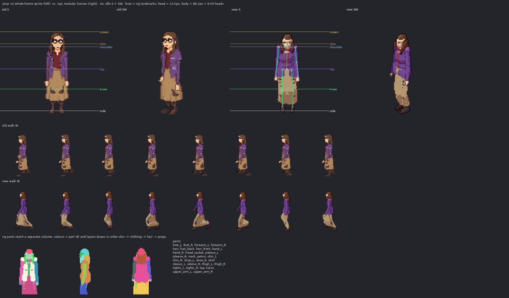

# amy: v2 sprite vs rig1 modular human

Measured from the shipped sheets (128x128 frames, pivot (64,116), 100 px = 185 cm, 2:1 dimetric).

| metric | v2 (old) | rig1 (new) | target |
|---|---|---|---|
| standing height, idle S (px) | 92 | 89 | 88.1 body + hair/feet in view (163 cm) |
| silhouette width, idle S (px) | 28 | 29 | shoulders 18.3px + arms |
| walk bob, W (px, crown range) | 1 | 2 | 1-2 px (lowest on 'down', highest on 'passing') |
| walk foot spread, W (px max/min) | 14/14 | 34/12 | stride ~ 1/3 height at contact, feet together at passing |
| head height (px) | - | 13.5 (24.9 cm) | ~1/7.3 of the body; enlarged a little (head_k) so faces read at 1x |
| heads tall | - | 6.54 | 7-7.5 realistic; ~6.5 here on purpose (head_k) |

Rig landmarks (screen y, S view): crown 27.9, chin 41.4, shoulder 44.6, hip 69.4, knee 91.8, sole 116.0

Body spec: {"leg": 1.0, "sh": 0.92, "tw": 0.9, "td": 0.95, "hip": 0.98, "waist": 0.9, "limb": 0.95, "arm_k": 0.95, "head_k": 1.12, "bust": 0.7, "neck": 0.95, "foot": 0.9, "hand": 0.92, "slouch": 0.2}

Gait: {"arm": 12, "elbow": 20, "bob": 0.8, "hip_roll": 3.0, "sway": 1.0, "twist": 4, "lean": 2.0}
