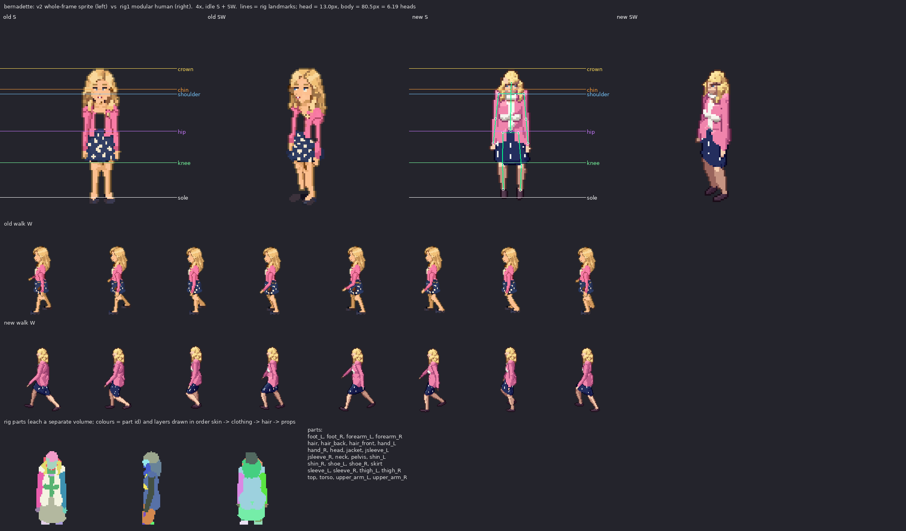

# bernadette: v2 sprite vs rig1 modular human

Measured from the shipped sheets (128x128 frames, pivot (64,116), 100 px = 185 cm, 2:1 dimetric).

| metric | v2 (old) | rig1 (new) | target |
|---|---|---|---|
| standing height, idle S (px) | 85 | 82 | 80.5 body + hair/feet in view (149 cm) |
| silhouette width, idle S (px) | 25 | 27 | shoulders 16.0px + arms |
| walk bob, W (px, crown range) | 1 | 3 | 1-2 px (lowest on 'down', highest on 'passing') |
| walk foot spread, W (px max/min) | 26/12 | 33/10 | stride ~ 1/3 height at contact, feet together at passing |
| head height (px) | - | 13.0 (24.1 cm) | ~1/7.3 of the body; enlarged a little (head_k) so faces read at 1x |
| heads tall | - | 6.19 | 7-7.5 realistic; ~6.5 here on purpose (head_k) |

Rig landmarks (screen y, S view): crown 35.5, chin 48.5, shoulder 51.3, hip 74.7, knee 94.3, sole 116.0

Body spec: {"leg": 0.96, "sh": 0.88, "tw": 0.9, "td": 0.96, "hip": 1.0, "waist": 0.84, "limb": 1.0, "arm": 1.03, "arm_k": 0.98, "head_k": 1.18, "bust": 1.0, "neck": 0.95, "foot": 0.84, "hand": 0.88}

Gait: {"arm": 20, "elbow": 18, "bob": 1.1, "hip_roll": 5.0, "sway": 1.4, "twist": 6, "lean": 0.5}
