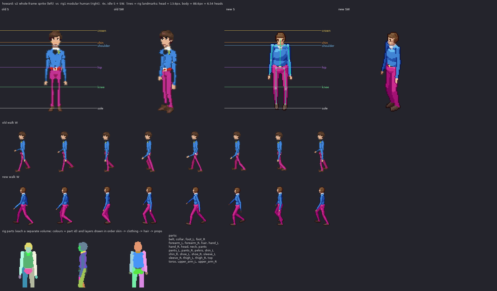

# howard: v2 sprite vs rig1 modular human

Measured from the shipped sheets (128x128 frames, pivot (64,116), 100 px = 185 cm, 2:1 dimetric).

| metric | v2 (old) | rig1 (new) | target |
|---|---|---|---|
| standing height, idle S (px) | 93 | 90 | 88.6 body + hair/feet in view (164 cm) |
| silhouette width, idle S (px) | 27 | 29 | shoulders 17.7px + arms |
| walk bob, W (px, crown range) | 1 | 2 | 1-2 px (lowest on 'down', highest on 'passing') |
| walk foot spread, W (px max/min) | 33/12 | 35/13 | stride ~ 1/3 height at contact, feet together at passing |
| head height (px) | - | 13.6 (25.1 cm) | ~1/7.3 of the body; enlarged a little (head_k) so faces read at 1x |
| heads tall | - | 6.54 | 7-7.5 realistic; ~6.5 here on purpose (head_k) |

Rig landmarks (screen y, S view): crown 27.4, chin 40.9, shoulder 44.4, hip 69.3, knee 91.8, sole 116.0

Body spec: {"leg": 1.0, "sh": 0.88, "tw": 0.84, "td": 0.84, "hip": 0.88, "waist": 0.84, "limb": 0.8, "arm_k": 0.84, "head_k": 1.12, "neck": 1.0, "foot": 0.95, "hand": 0.95}

Gait: {"arm": 22, "elbow": 18, "bob": 1.3, "hip_roll": 3.5, "sway": 1.4, "twist": 7, "lean": 0.5}
