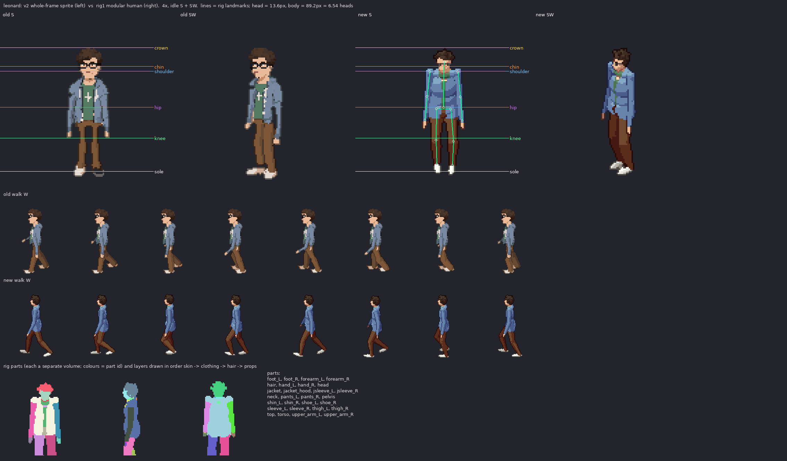

# leonard: v2 sprite vs rig1 modular human

Measured from the shipped sheets (128x128 frames, pivot (64,116), 100 px = 185 cm, 2:1 dimetric).

| metric | v2 (old) | rig1 (new) | target |
|---|---|---|---|
| standing height, idle S (px) | 93 | 92 | 89.2 body + hair/feet in view (165 cm) |
| silhouette width, idle S (px) | 31 | 31 | shoulders 20.2px + arms |
| walk bob, W (px, crown range) | 0 | 2 | 1-2 px (lowest on 'down', highest on 'passing') |
| walk foot spread, W (px max/min) | 30/15 | 35/12 | stride ~ 1/3 height at contact, feet together at passing |
| head height (px) | - | 13.6 (25.2 cm) | ~1/7.3 of the body; enlarged a little (head_k) so faces read at 1x |
| heads tall | - | 6.54 | 7-7.5 realistic; ~6.5 here on purpose (head_k) |

Rig landmarks (screen y, S view): crown 26.8, chin 40.4, shoulder 43.8, hip 69.9, knee 92.1, sole 116.0

Body spec: {"leg": 0.98, "sh": 1.0, "tw": 1.0, "td": 1.0, "hip": 0.95, "waist": 0.96, "limb": 1.0, "arm": 1.06, "arm_k": 0.95, "head_k": 1.12, "neck": 0.95, "foot": 1.0, "hand": 1.0, "slouch": 0.15}

Gait: {"arm": 10, "elbow": 16, "bob": 1.0, "hip_roll": 3.0, "sway": 1.0, "twist": 5, "lean": 1.5}
