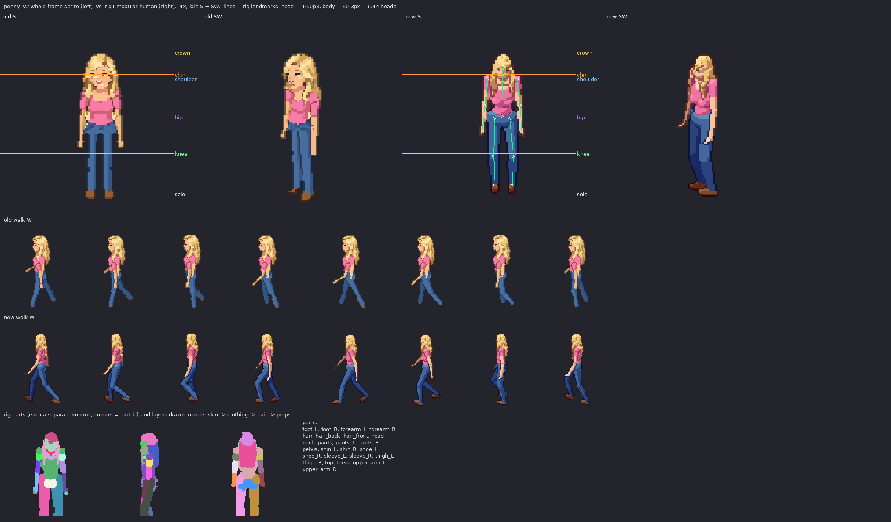

# penny: v2 sprite vs rig1 modular human

Measured from the shipped sheets (128x128 frames, pivot (64,116), 100 px = 185 cm, 2:1 dimetric).

| metric | v2 (old) | rig1 (new) | target |
|---|---|---|---|
| standing height, idle S (px) | 94 | 91 | 90.3 body + hair/feet in view (167 cm) |
| silhouette width, idle S (px) | 30 | 29 | shoulders 18.8px + arms |
| walk bob, W (px, crown range) | 1 | 2 | 1-2 px (lowest on 'down', highest on 'passing') |
| walk foot spread, W (px max/min) | 33/7 | 41/11 | stride ~ 1/3 height at contact, feet together at passing |
| head height (px) | - | 14.0 (25.9 cm) | ~1/7.3 of the body; enlarged a little (head_k) so faces read at 1x |
| heads tall | - | 6.44 | 7-7.5 realistic; ~6.5 here on purpose (head_k) |

Rig landmarks (screen y, S view): crown 25.7, chin 39.8, shoulder 42.8, hip 67.0, knee 90.3, sole 116.0

Body spec: {"leg": 1.02, "sh": 0.92, "tw": 0.88, "td": 0.92, "hip": 0.92, "waist": 0.84, "limb": 0.92, "arm_k": 1.0, "head_k": 1.14, "bust": 0.9, "neck": 1.05, "foot": 0.86, "hand": 0.9}

Gait: {"stride": 0.3, "arm": 19, "elbow": 14, "bob": 1.0, "hip_roll": 5.0, "sway": 1.6, "twist": 6, "lean": 1.0}
