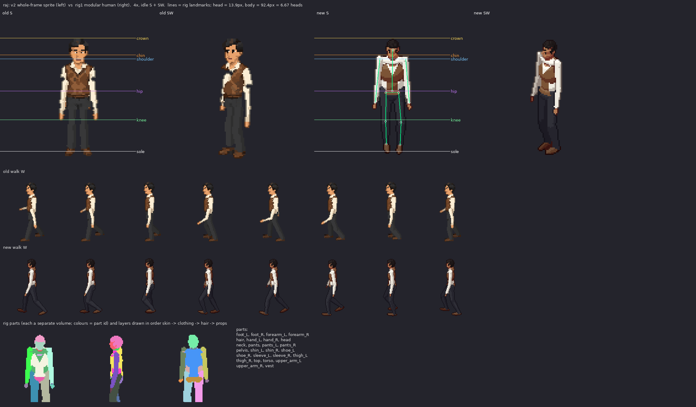

# raj: v2 sprite vs rig1 modular human

Measured from the shipped sheets (128x128 frames, pivot (64,116), 100 px = 185 cm, 2:1 dimetric).

| metric | v2 (old) | rig1 (new) | target |
|---|---|---|---|
| standing height, idle S (px) | 96 | 95 | 92.4 body + hair/feet in view (171 cm) |
| silhouette width, idle S (px) | 32 | 33 | shoulders 20.9px + arms |
| walk bob, W (px, crown range) | 1 | 2 | 1-2 px (lowest on 'down', highest on 'passing') |
| walk foot spread, W (px max/min) | 15/15 | 35/13 | stride ~ 1/3 height at contact, feet together at passing |
| head height (px) | - | 13.9 (25.7 cm) | ~1/7.3 of the body; enlarged a little (head_k) so faces read at 1x |
| heads tall | - | 6.67 | 7-7.5 realistic; ~6.5 here on purpose (head_k) |

Rig landmarks (screen y, S view): crown 23.6, chin 37.4, shoulder 40.5, hip 66.9, knee 90.3, sole 116.0

Body spec: {"leg": 1.0, "sh": 1.0, "tw": 0.95, "td": 0.95, "hip": 0.93, "waist": 0.92, "limb": 0.95, "arm": 1.03, "arm_k": 0.95, "head_k": 1.1, "neck": 1.0, "foot": 1.0, "hand": 0.92}

Gait: {"arm": 8, "elbow": 14, "bob": 0.9, "hip_roll": 3.0, "sway": 1.0, "twist": 3, "lean": 1.0}
