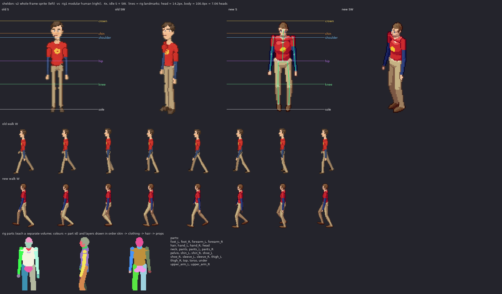

# sheldon: v2 sprite vs rig1 modular human

Measured from the shipped sheets (128x128 frames, pivot (64,116), 100 px = 185 cm, 2:1 dimetric).

| metric | v2 (old) | rig1 (new) | target |
|---|---|---|---|
| standing height, idle S (px) | 104 | 102 | 100.0 body + hair/feet in view (185 cm) |
| silhouette width, idle S (px) | 27 | 34 | shoulders 22.0px + arms |
| walk bob, W (px, crown range) | 2 | 1 | 1-2 px (lowest on 'down', highest on 'passing') |
| walk foot spread, W (px max/min) | 12/12 | 37/14 | stride ~ 1/3 height at contact, feet together at passing |
| head height (px) | - | 14.2 (26.2 cm) | ~1/7.3 of the body; enlarged a little (head_k) so faces read at 1x |
| heads tall | - | 7.06 | 7-7.5 realistic; ~6.5 here on purpose (head_k) |

Rig landmarks (screen y, S view): crown 16.0, chin 30.2, shoulder 34.8, hip 61.3, knee 87.7, sole 116.0

Body spec: {"leg": 1.04, "sh": 0.97, "tw": 0.85, "td": 0.84, "hip": 0.88, "waist": 0.86, "limb": 0.84, "arm_k": 0.86, "head_k": 1.04, "neck": 1.12, "foot": 1.0, "hand": 0.86}

Gait: {"arm": 9, "elbow": 8, "bob": 0.6, "hip_roll": 1.8, "sway": 0.5, "twist": 2.5, "lean": 0.0}
